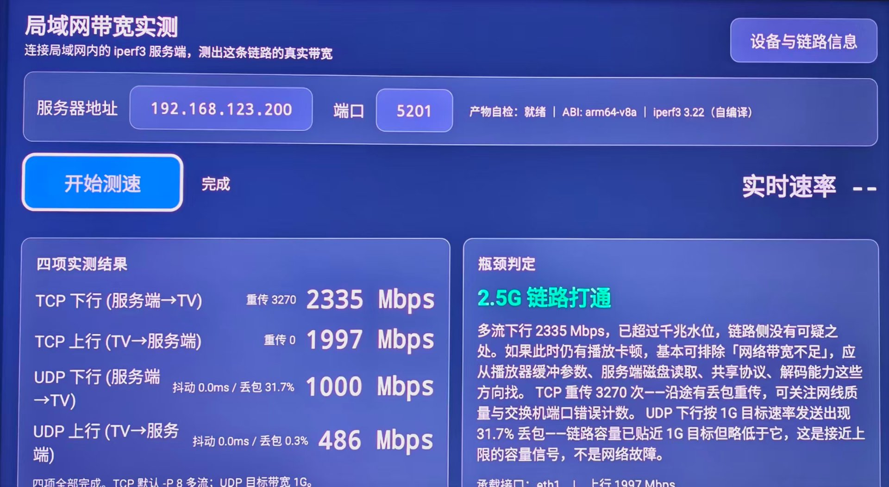
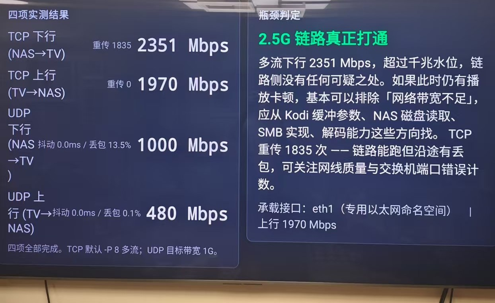

<div align="center">

# tviperf

**Android TV 局域网测速工具 —— 用真 iperf3，测电视到 NAS 的真实带宽**

一键测出 TCP/UDP 四项带宽，自动给出链路档位判断与瓶颈排查方向。
专为电视设计：遥控器全流程操作，无需输入法、无需浏览器。

[]()
[]()
[]()

</div>

---

## 它解决什么问题

想搞清楚「电视放 4K 蓝光原盘为什么卡」，第一件事是知道**电视到 NAS 这条链路到底能跑多少**。但这件事在电视上出奇地难：

- 电视上**没有浏览器**，跑不了网页测速；
- 没有终端，装不了 iperf；
- 手机/电脑上的测速 App 测的是**手机/电脑到 NAS**，不是电视这条链路；
- 就算用网页测速凑合，浏览器测速有**客户端 CPU 天花板**，千兆以上链路的数字会严重失真，根本不能用。

**tviperf 把 iperf3 直接搬进电视**。在电视上装一个 APK，遥控器点「开始测速」，十多秒后给出四项实测数字和结论。

<div align="center">


</div>

一次典型实测（2.5G 内网，电视有线）：

| 项目 | 结果 |
|---|---|
| TCP 下行（服务端→TV，8 流） | **2351 Mbps**（重传 1835） |
| TCP 上行（TV→服务端） | **1970 Mbps**（重传 0） |
| UDP 下行 | 1000 Mbps（丢包 13.5%，受 1G 目标带宽封顶） |
| UDP 上行 | 480 Mbps（丢包 0.1%） |

测完自动输出档位判断，例如「2.5G 链路真正打通，若播放仍卡顿，应从播放器缓冲、NAS 磁盘、共享协议方向排查，而不是网络」。

## 功能

- 📺 **TV 原生 UI**：焦点态高亮、数字键盘输入 IP/端口，遥控器全程可操作
- 🔢 **四项测试**：TCP 上/下行（默认 8 并发流）+ UDP 上/下行（1G 目标带宽），每项 10 秒
- ⚖️ **自动瓶颈判定**：只采信 iperf3 多流 JSON 结果，输出档位结论与下一步排查方向
- 🧰 **设备与链路面板**：接口名 / IP / 网关 / MTU / USB 网卡 VID:PID 等事实信息，以及免 root 下的合理推断（与实测读数视觉区分）
- 📡 **实时速率显示**：测试进行中实时刷新收发速率
- 🔒 **最小权限**：仅申请 `INTERNET` 与 `ACCESS_NETWORK_STATE`，不碰 USB 设备、不做任何越界行为
- 📦 **双架构**：`arm64-v8a` + `armeabi-v7a`，兼容 32 位电视 SoC
- 🖥️ **广泛兼容**：同时注册 Android TV 主屏入口（`LEANBACK_LAUNCHER`）与普通桌面入口（`LAUNCHER`），非 Google 认证的安卓电视（品牌自研 launcher）也能正常显示图标

## 工作原理（为什么它能测准）

APK 内置了 iperf3 **3.17.1** 的原生二进制（`libiperf3.so` 形式打包）。安装时系统把它解压到 `nativeLibraryDir`——这是 Android 10+ W^X 策略下唯一允许执行原生文件的位置——测速时以子进程方式运行真正的 iperf3，并解析其 JSON 输出。

因此它测的就是标准 iperf3 数字，与你在电脑上跑 `iperf3 -c` 完全等价，没有浏览器测速的 CPU 天花板问题。

> ⚠️ **版本一致**：iperf3 的控制协议对版本敏感。客户端内置 3.17.1，服务端请尽量也用 3.17.1，否则可能出现反向测试异常或字段缺失。

## 服务端准备（一分钟）

在 NAS / 电脑 / 路由器上任选一处跑一个 iperf3 服务端。Docker 用户：

```bash
docker run -d --name iperf3-server \
  -p 5201:5201/tcp -p 5201:5201/udp \
  --restart unless-stopped \
  alpine:3.21 sh -c "apk add --no-cache iperf3 && iperf3 -s -p 5201"
```

或者直接在任意机器上运行 `iperf3 -s`（需安装 iperf3 3.17.1）。

## 电视端使用

1. 下载 Release 中的 APK，用 U 盘、电视自带安装器或 `adb install` 装到电视（首次需允许"未知来源"）
2. 打开应用，用遥控器点击**服务器地址**，用屏幕数字键盘输入服务端 IP（例如 NAS 的地址），端口默认 `5201`
3. 点**开始测速**，等待四项依次完成
4. 右侧自动给出瓶颈判定结论；点**设备与链路信息**可查看接口 / USB 网卡等细节

地址和端口会记住，下次打开直接测。

> 🔍 **装完在首页找不到图标？** 本应用同时注册了两个桌面入口：标准 Android TV 会显示在主屏，非 Google 认证的安卓电视（品牌自研 launcher）会显示在普通应用列表。若首页仍看不到，先到「设置 → 应用管理 / 全部应用」确认是否安装成功——能找到就说明装上了，部分机型需要**重启电视**后 launcher 才会刷新图标。

## 怎么读结果

- **TCP 两项是主指标**。下行明显低于上行、或卡在某个固定水位时，结合「设备与链路信息」面板判断：
  - 百兆量级 → 多半插在了百兆口/百兆线上
  - 上行远高于下行（如 750/<500）→ 典型的 USB 转以太网 `cdc_ncm` 通用驱动特征
  - 2000+ Mbps → 2.5G 链路已打通，播放卡顿请去查播放器缓冲与磁盘
- **UDP 是辅助证据**：目标带宽 1G，若链路只有 500M，丢包率会很高——这本身就是"链路只有 500M"的直接证据，不是故障
- 判定**只接受 iperf3 多流结果**；浏览器测速的数字因客户端 CPU 天花板不可信

## 从源码构建

```bash
git clone https://github.com/CloudDragon3/tviperf.git
cd tviperf
# 需要 JDK 17 + Android SDK (API 34)
./gradlew :app:assembleRelease
```

无签名配置时自动回退 debug 签名，保证任何机器都能出包。

## 项目结构

```
app/src/main/java/io/github/tviperf/
├── iperf/    # iperf3 参数构造、子进程调度、JSON 解析、瓶颈判定
├── link/     # 接口/USB 网卡信息采集、实时速率采样、免 root 推断
├── root/     # root 可用时的 ethtool 读数增强（可选）
├── ui/       # 主界面、诊断面板、数字键盘
└── util/     # 格式化工具
```

## License

[MIT](LICENSE)
